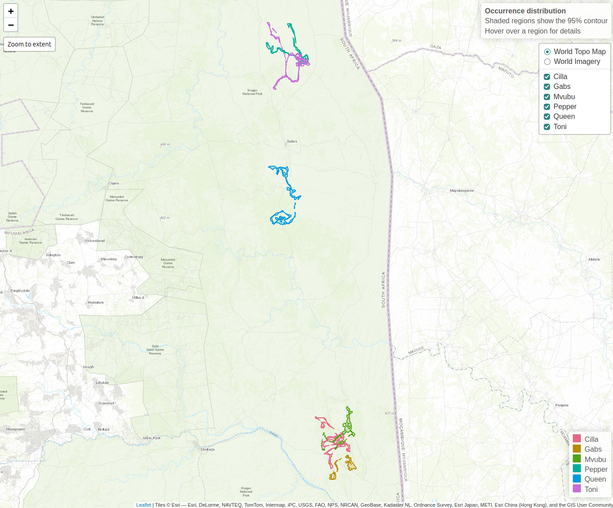

# Estimate Occurrence Distribution (Kriging)

MoveApps

GitHub repository: https://github.com/movestore/ctmm_occurrence

  

## Description
Use a fitted continuous-time movement model (CTMM) to estimate the occurrence
distribution for each of a set of tracked animals using Kriging, with contours
at one or more isopleth levels.

## Documentation
An occurrence distribution describes where an animal may have been during the
period it was tracked. The ctmm package uses Kriging to estimate the occurrence
distribution. The fitted movement model for each animal is used to infer the
most likely path between the recorded locations along with the uncertainty
around that path.

When recorded locations are dense, the occurrence distribution fits closely
to the recorded locations. When they are sparse, the possible paths the animal
took are more numerous, and the occurrence distribution is wider.

This App calculates one occurrence distribution per animal in the input data.
It then derives the contours for the provided isopleth levels from each of
those distributions. These results are provided in several forms:

- an interactive map of the occurrence distributions of all animals on a
  basemap
- a PDF containing static maps of all animals' occurrence distributions at the
  given isopleth levels as well as each animal's individual occurrence
  distribution
- the contours as a GeoPackage
- the occurrence distributions as image raster files

The occurrence distributions are also passed on to the next App in the
Workflow.

Note that the occurrence distribution is a distinct concept from the
range distribution estimated by the
*Autocorrelated Kernel Density Estimate (aKDE)* App. The home range estimate
attempts to describe the space an animal uses over the long term. The occurrence
distribution, on the other hand, attempts to describe where an animal may
have actually been during the observation period itself.

This App is part of a `ctmm` Workflow. You must run the *Fit a
Continuous-Time Movement Model (ctmm)* App before this one, as its output is
necessary to calculate the occurrence distributions.

See the ctmm documentation of [`occurrence()`][1] for more information on the
method.

[1]: https://ctmm-initiative.github.io/ctmm/reference/occurrence.html

### Application scope
#### Generality of App usability
This App was developed for any taxonomic group.

#### Required data properties
The App needs a fitted movement model for each animal. Unlike the home range
Apps, it does not require range-resident behavior.

### Input type
`ctmm model with data`: a list with two elements:

1. `model`: a list containing the selected `ctmm` model for each animal.
2. `data`: the tracking data (an object of type `telemetry.list`).

### Output type
`ctmm ud with data`: a list with three elements:

1. `model`: the list of `ctmm` models from the input.
2. `uds`: a list containing the occurrence distribution (an object of class
   `UD`) for each animal.
3. `data`: the tracking data from the input (an object of type
   `telemetry.list`).

### Artefacts
The contours, plots and map are created for each isopleth level given in the
**Isopleth level(s)** setting.

`occurrence_map.html`: an interactive map of the occurrence distributions of
all animals, as a single HTML file that can be opened in a web browser. The map
shows each animal's occurrence distribution contours for each of the
requested isopleth levels.

`occurrence_plots.pdf`: static plots of the occurrence distributions,
including an overall plot with all animals for each isopleth level as well as
plots for each animal individually.

`occurrence.gpkg`: a GeoPackage with the occurrence distribution contours of
all animals as polygons, with one feature per animal and isopleth level (a
feature may consist of multiple polygons). It contains the following columns:
  - `id`: the name of the animal.
  - `level`: the isopleth level.
  - `name`: the contour name given by `ctmm`, e.g. "Cilla 95% est".

The coordinates are in the local map projection that ctmm uses for the
tracking data.

`occurrence_uds.zip`: a zip archive with one GeoTIFF file per animal
(`<animal>.tif`) containing its occurrence distribution in raster format.
Each cell's value is the probability that the animal was located within the
contour line passing through that cell during the tracking period.
The coordinates are in the local map projection that ctmm uses for
the tracking data.

### Settings
**Isopleth level(s) (`isopleth_levels`):** The coverage levels of the
occurrence distribution to draw contours for. Each level should be a number
between 0 and 1. If multiple are provided, separate them with commas. Each
value gives the smallest area in which the animal had the given probability of
being present during the tracking period. For instance, 0.95 gives the area
within which the animal was 95% likely to have been present during the
tracking period. Defaults to `0.95`.

### Changes in output data
The App adds the occurrence distribution of each animal to the input data (see
[Output type](#output-type)). The models and tracking data remain unchanged.

### Errors and null handling
**Setting `Isopleth level(s)`:** If the setting is empty, or if any value is
not a number strictly between 0 and 1, the App stops with an error message
that names the invalid value(s). A common mistake is to enter a percentage
instead of a proportion (e.g. 95 instead of 0.95) or to separate values with
something other than commas (e.g. spaces).

**Many isopleth levels:** Plots and maps become hard to read with many
levels, as the contours of nearby levels overlap and their colours become
similar. No more than two or three levels is recommended.

**Performance:** For large data sets, calculating the occurrence distributions
may take some time.

### Technical details
The occurrence distributions are calculated with [`ctmm::occurrence()`][1],
with the function's default settings. Each animal's occurrence distribution
is based on its own fitted model.

The contours are calculated with `ctmm::SpatialPolygonsDataFrame.UD()` at each
isopleth level. The rasters are written with ctmm's `writeRaster()` method for
UDs, which writes the cumulative distribution function (CDF) by default. The
PDF plots use ctmm's `plot()` method; the map is made with the `leaflet`
package.

Note: ctmm 1.3.x does not mark holes within a contour. This App identifies
nested contour rings so that areas inside the outer contour that are not part
of the occurrence area at the indicated isopleth level are left out of the
output polygons.

On the map only, the contour coordinates are rounded to about 1 m to keep the
HTML file small. The GeoPackage keeps the full precision.

Long gaps in the tracking data are only partially interpolated to prevent
the occurrence distribution from disproportionately representing the movement
model rather than the observed locations. In these cases, the occurrence
distribution only represents times close to the observed locations on either
side of the gap. For models without any autocorrelation (IID), the locations are
not interpolated at all.

The Kriging method for occurrence distributions is described in Fleming,
C. H., Fagan, W. F., Mueller, T., Olson, K. A., Leimgruber, P., & Calabrese,
J. M. (2016). Estimating where and how animals travel: An optimal framework
for path reconstruction from autocorrelated tracking data. *Ecology*, 97(3),
576–582. https://doi.org/10.1890/15-1607.1

The `ctmm` package is described in Calabrese, J. M., Fleming, C. H., &
Gurarie, E. (2016). ctmm: An R package for analyzing animal relocation data as
a continuous-time stochastic process. *Methods in Ecology and Evolution*,
7(9), 1124–1132. https://doi.org/10.1111/2041-210X.12559
