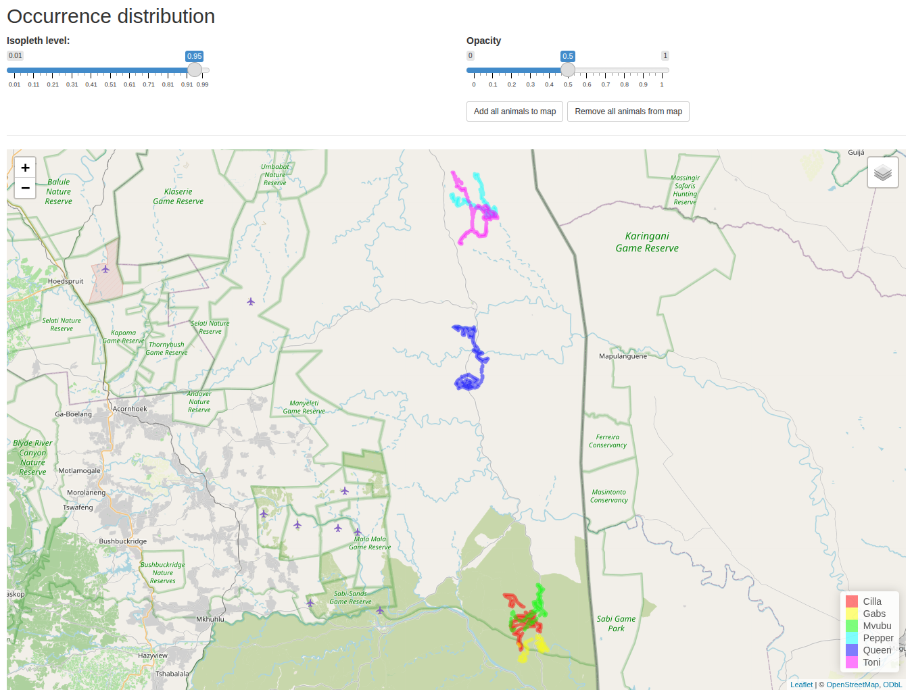

# Estimate Occurrence Distribution (Kriging)

MoveApps

GitHub repository: https://github.com/movestore/ctmm_occurrence

  

## Description
Use a fitted continuous-time movement model (CTMM) to estimate the occurrence
distribution for each of a set of animals using Kriging and display the
results on an interactive map.

## Documentation
This App calculates one occurrence distribution per track present in the input
data and plots its contour on an interactive map.

An occurrence distribution describes where an animal may have been during the
period it was tracked. The ctmm package uses Kriging to estimate the occurrence
distribution. The fitted movement model for each animal is used to infer the
most likely path between the recorded locations along with the uncertainty
around that path.

When recorded locations are dense, the occurrence distribution fits closely
to the recorded locations. When they are sparse, the possible paths the animal
took are more numerous, and the occurrence distribution is wider.

Note that the occurrence distribution is a distinct concept from the
range distribution estimated by the
*Autocorrelated Kernel Density Estimate (aKDE)* App. The home range estimate
attempts to describe the space an animal uses over the long term. The occurrence
distribution, on the other hand, attempts to describe where an animal may
have actually been during the observation period itself.

This App is part of a `ctmm` Workflow. You must run the *Fit a
Continuous-Time Movement Model (ctmm)* App before this one, as its output is
necessary to calculate the occurrence distributions.

See the ctmm documentation of [`occurrence()`][1] for more information on the
method.

[1]: https://ctmm-initiative.github.io/ctmm/reference/occurrence.html

### Application scope
#### Generality of App usability
This App was developed for any taxonomic group.

#### Required data properties
The App needs a fitted movement model for each animal. Unlike the home range
Apps, it does not require range-resident behavior.

### Input type
`ctmm model with data`: a list with two elements:

1. A list containing the selected `ctmm` model for each animal.
2. The tracking data (an object of type `telemetry.list`).

### Output type
`ctmm ud with data`: a list with three elements:

1. `model`: the list of `ctmm` models from the input.
2. `uds`: a list containing the occurrence distribution (an object of class
   `UD`) for each animal.
3. `data`: the tracking data from the input (an object of type
   `telemetry.list`).

### Artefacts
`occurrence.gpkg`: a GeoPackage with the occurrence distribution contour of
each animal at the **Isopleth level** selected in the App. Each animal is
represented by one feature (which may consist of multiple polygons) that
includes a `name` column containing the animal's name and the selected isopleth
level (e.g., "Cilla 95% est"). The coordinates are in the local map projection
that ctmm uses for the tracking data.

`occurrence_uds.zip`: a zip archive with one GeoTIFF file per animal
(`<animal>.tif`) containing its occurrence distribution in raster format.
Each cell's value is the probability that the animal was located within the
contour line passing through that cell during the tracking period. For
example, the cells with a value of 0.95 or less together make up the
95% contour. The coordinates are in the local map projection that ctmm uses for
the tracking data.

### Settings
**Isopleth level**: The coverage level of the occurrence distribution. This is
the smallest area in which the animal had the given probability of being
present during the tracking period. For example, a level of 0.95 gives the area
within which the animal was 95% likely to have been present during the tracking
period. Defaults to 0.95.

**Opacity**: The opacity of the filled contours on the map, from 0
(transparent) to 1 (opaque). Defaults to 0.5.

**Add all animals to map** / **Remove all animals from map**: Show or hide
all animals on the map. Individual animals can be toggled using the checkboxes
in the layer menu in the top-right corner of the map itself.

**Store settings**: Click to store the current settings of the App for future
Workflow runs.

**Restore default settings**: Click to restore the App's default settings.

### Changes in output data
The App adds the occurrence distribution of each animal to the input data (see
[Output type](#output-type)). The models and tracking data remain unchanged.

### Errors and null handling
**Performance:** For large data sets, calculating the occurrence distribution
may take some time.

**Access to the App's window:** The preceding *Fit a Continuous-Time Movement
Model (ctmm)* App can take a long time to run (up to hours). Like all Apps with
an interactive window, this App's window (the "OPEN APP UI" button) can only
be opened for 8 hours after the Workflow has run. To open it again later, the
Workflow has to be run again. To avoid fitting the models again, first pin the
Workflow to the *Fit a Continuous-Time Movement Model (ctmm)* App (menu at
the top-right corner of that App, *"Pin to this App"*). An App can only be
pinned once it has run and produced results.

### Technical details
The occurrence distributions are calculated with [`ctmm::occurrence()`][1],
with the function's default settings. Each animal's occurrence distribution
is based on its own fitted model.

The contours are calculated with `ctmm::SpatialPolygonsDataFrame.UD()` at the
selected isopleth level. The rasters are written with ctmm's `writeRaster()`
method for UDs, which writes the cumulative distribution function (CDF) by
default.

Note: ctmm 1.3.x does not mark holes within a contour. This App identifies
nested contour rings so that areas inside the outer contour that are not part
of the occurrence area at the selected isopleth level are left out of the
output polygons.

Long gaps in the tracking data are only partially interpolated to prevent
the occurrence distribution from disproportionately representing the movement
model rather than the observed locations. In these cases, the occurrence
distribution only represents times close to the observed locations on either
side of the gap. For models without any autocorrelation (IID), the locations are
not interpolated at all.

The Kriging method for occurrence distributions is described in Fleming,
C. H., Fagan, W. F., Mueller, T., Olson, K. A., Leimgruber, P., & Calabrese,
J. M. (2016). Estimating where and how animals travel: An optimal framework
for path reconstruction from autocorrelated tracking data. *Ecology*, 97(3),
576–582. https://doi.org/10.1890/15-1607.1

The `ctmm` package is described in Calabrese, J. M., Fleming, C. H., &
Gurarie, E. (2016). ctmm: An R package for analyzing animal relocation data as
a continuous-time stochastic process. *Methods in Ecology and Evolution*,
7(9), 1124–1132. https://doi.org/10.1111/2041-210X.12559
